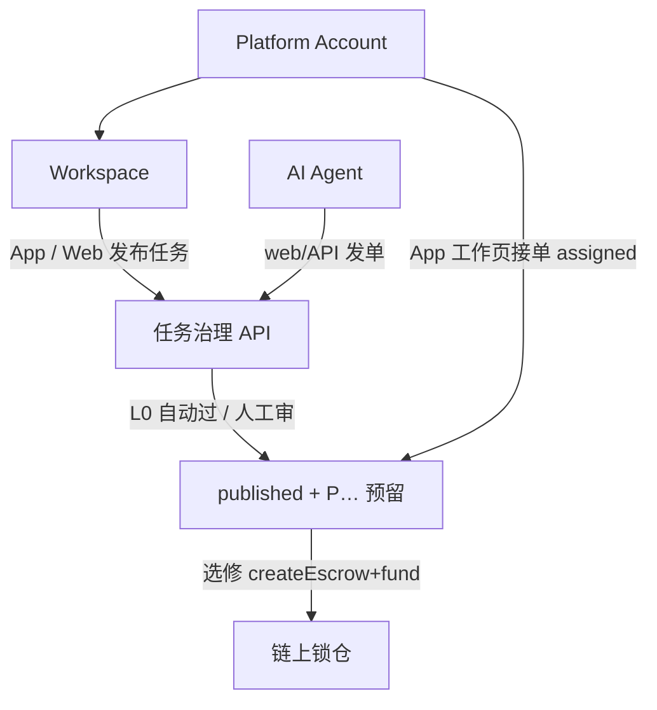

> **规范源文件**：由 MetaRepo `spec/` 同步，请勿直接编辑本页。

# 客户端与平台总览

**版本**: v0.3-draft · **最后更新**: 2026-10-07

## 1. 产品矩阵

| 端 | 仓库 | 用户 | 核心能力 |
|----|------|------|----------|
| **DoerFlow App（主壳）** | `wallet` | 同一 Platform Account 下的发布者、执行者与持币用户 | **首页 / 工作 / 发布 / 资金 / 我的**；转账、任务发布与管理，并渐进吸收 worker 接单、原生证据与社交任务能力 |
| **旧 Worker App（迁移期）** | `worker` | 既有任务执行者 | 接单、相机/GPS/问卷、社交清单+截图；冻结新增产品面，能力迁移完成后保留两个版本再退役 |
| **Web App** | `web` | 浏览者、发布者、执行者、Creator / 开发者 | Home / Work / Create / Money / Build / Devices / Account；可浏览、发布和管理任务，原生证据步骤引导 App |
| **管理平台** | `admin` | 平台运营 | 订单审核、风控告警、发布审批 |
| **Agent Trading SDK** | `shared/sdk` · `sdk/python` | 云 / Agent 开发者 | 发现、报价、`signReceipt`、Merkle（无 App）；生产用 API Key 或 M2M |
| **开发者控制台** | `web` `/developers` | 云 / Agent 开发者 | 自助发 Key、注册 Skill、轮换 webhook、看作业流水 |
| **Agent Runtime（示例）** | MetaRepo `scripts/example-agent-runner.mjs` | Agent 开发者 | 拉作业、调工具、交回执；非独立仓 |
| **Endpoint Agent** | api `/endpoints` | 本机执行器 | Desktop 白名单能力；非 worker App |
| **IoT Device HTTP** | api `/devices` | 设备 / 网关 | 注册、心跳、遥测；非 Matter |
| **SyncroBrain 时间窗入账** | api `/integrations/syncrobrain/telemetry-credits` | SyncroBrain Gateway | TB 聚合 digest → 账本；非 MQTT |

### Android 分发（sideload）

迁移期 **wallet** / **worker** 均以 Android sideload APK 安装，**不上架 Play Store**。`DoerFlow-App.apk` 是统一 DoerFlow App 的主分发产物；`DoerFlow-Wallet.apk` 作为同一主产物的兼容别名至少保留两个正式版本，`DoerFlow-Worker.apk` 同期保留旧接单流程与迁移提示。MetaRepo `pnpm pack:publish` 发布到 `DoerFlow/downloads`。统一 App 达到旧 worker 能力对等后，旧 worker 至少保留两个正式版本的迁移提示、配置 scheme 深链与数据导出/重连说明，再停止发布。

## 2. 任务受众与类型

| 受众 | 代码 | 执行端 | 接单 | 验收 |
|------|------|--------|------|------|
| **AI Agent** | `audience=agent` | 协议内 Agent / web | 自动 claim（价≤上限） | 链上规则 |
| **人类** | `audience=human` | 统一 App；迁移期 worker | 自愿 accept | 发布者 verify 或免验收 |
| 社交子类 | `taskType=social` | 统一 App；迁移期 worker | 同上 | 默认人工审批 |

| 链上 Skill | `skill` | web | Escrow | 合约 |

详见 [TASK_SYSTEM.md](./TASK_SYSTEM.md)。

社交平台示例：抖音、小红书、知乎 — **点赞、观看、收藏** 等（须符合当地法律与平台 ToS，见合规章节）。

## 3. 发布与交易规则（摘要）

> 详细流程见 [TASK_GOVERNANCE.md](./TASK_GOVERNANCE.md)

1. 用户在统一 **DoerFlow App** 或 Web Create 填写任务模板并提交；`published` 时创建平台 Escrow 预留（`escrowId` 以 `P` 开头，status `Reserved`），**不会**立刻锁链上 ETH
2. 任务进入 **治理流水线**：风险评分 → **运营审核通过** 后才 `published`（Agent 与人类同一闸门）
3. **仅 `published` 状态** 的任务对统一 App 工作页及迁移期 worker 可见并可接单
4. 接单进入 `assigned` 后，发布者可选修 `createEscrow` + `fundEscrow` 并绑定 `onChainEscrowId`；执行者 `deliver` → **`submitted`**（须验收）→ 发布者 `verify` → 已锁仓则合约放款，否则账本结算；争议进 admin 仲裁队列。同一账号可在不同任务中处于不同上下文，但同一任务的利益冲突与权限仍由 Casbin/状态机约束

**原则**：未通过平台确认的任务 **不得** 对执行端展示、不得扣款结算。

## 4. 规格文档索引

| 文档 | 内容 |
|------|------|
| [WALLET.md](./WALLET.md) | 统一 DoerFlow App 主壳 |
| [WORKER.md](./WORKER.md) | 旧 Worker App 迁移与安全边界 |
| [ADMIN.md](./ADMIN.md) | 管理平台 |
| [DEVELOPER.md](./DEVELOPER.md) | Agent Trading SDK · Creator `/developers` |
| [TASK_GOVERNANCE.md](./TASK_GOVERNANCE.md) | 审批分级、风控、状态机 |
| [CHANNELS.md](./CHANNELS.md) | 五通道任务经济 |
| [AGENT_RUNTIME.md](./AGENT_RUNTIME.md) | Agent 执行循环 |
| [ENDPOINT.md](./ENDPOINT.md) | 电脑/手机执行面 |
| [SPEC.md](./SPEC.md) | 协议总规格 |
| [REPOS.md](./REPOS.md) | 仓库依赖 |

## 5. 统一产品模型、双证明与客户端边界

- **统一账号**：同一 Platform Account 可发布、接单、开发与管理资产；“发布者/执行者/Creator/运营”是当前 Workspace 与资源上的使用上下文，不是不同账号类型。
- **五个核心对象**：Platform Account、Linked Wallets、Workspaces、Capabilities、Assets。账号/组织关系来自 Logto；套餐与配额来自 Entitlement；资源动作来自 Casbin；钱包控制权来自 SIWE。
- **能力状态**：所有客户端统一显示 Available / Beta / Lab / Roadmap。兼容 API 的 `production` 映射 Available、`disabled` 不展示；不得新增各端私有状态词。

- **web**：平台 Logto 会话、钱包连接、SIWE 会话分别展示；显示钱包链接状态、会员快照、Pro / Ultra / Enterprise 与配额。公开市场和钱包直签保持可用。Creator DApp 用户可见文案走 en + zh-CN locale。
- **web IA**：主导航固定为 **Home / Work / Create / Money / Build / Devices / Account**。Home 可浏览市场；Work 浏览可接任务与管理执行；Create 发布/管理任务和 Agent/Skill；Money 聚合余额四态与资金工具；Build 承载开发者能力；Devices 管理 Endpoint/IoT Assets；Account 管理 Platform Account、Workspace、Linked Wallets 与 Capabilities。
- **web 任务边界**：Web 可浏览、发布与管理任务，也可完成纯 Web 证据流程；相机、GPS、系统分享、社交目标 App 等原生证据步骤必须显示“在 DoerFlow App 继续”，不得伪造为 Web 已采集。
- **web Home / market**：可展示 `/capabilities` 的 profile Tag（`/capabilities.profile`，与 `/version.profile` 相同）与 commerce readiness Tag（归一化为 Available/Beta/Lab/Roadmap），用于本地 DX 的只读诊断。加载失败 Alert 可 Retry（`market.retry`）。
- **web `/login`**：`HeadlessLoginPanel` 可经 `@luminaryworks/auth-react` Experience API 暴露注册（`showRegister`）；仍为 Logto 平台账号，**不是**钱包注册。
- **admin `/login`**：本地默认 `NEXT_PUBLIC_ADMIN_LOGIN_MODE=headless`（无 MFA）。生产强制 MFA 时用 `hosted` + Logto Hosted。测试：`pnpm e2e:admin:mfa`（临时 Mandatory，结束后恢复）。Headless MFA **阻塞于** auth-react；禁止自造 MFA UI。见 [ADMIN.md](./ADMIN.md)。
- **web `/account`**：可展示 `/capabilities` 的 profile Tag（`/capabilities.profile`，与 `/version.profile` 相同）与 entitlement.mode Tag（`/capabilities.entitlement.mode`），诊断语义与 `/membership` 相同。会员加载失败时 membership Down Alert 提供 Retry（`account.retry`）。会员卡片链到 `/developers`。
- **web `/membership`**：走 `/platform/commerce/*`；需 `DEPLOYMENT_PROFILE=control-plane`、`ENTITLEMENT_MODE=enforce`、Entitlement `:3040`。standalone 下 commerce **503**。页面可展示部署档位 Tag（`/capabilities.profile`，与 `/version.profile` 相同）与 entitlement.mode Tag（`/capabilities.entitlement.mode`），用于说明 control-plane / entitlement 关闭时 commerce BFF **503**。catalog / offerings 失败（**503** / `ENTITLEMENT_SERVICE_UNAVAILABLE`）时 web 展示 `membership.commerceUnavailable` Alert，而非空结算页；commerceUnavailable / catalog 加载失败可 Retry（`membership.retry`）。全局 `AccessErrorBanner` 亦会展示拦截器 `resolveAccessError` 将其标为 `kind: error`（与会员页 Alert 并存）。**会员 / MoR 只经 LuminaryWorks Entitlement（统一）**；DoerFlow **不**自建 Creem / Polar / Paddle 或其它 MoR checkout。**Lab tip**：Sepolia Vault 充值并同步账本后，Entitlement 若返回 `doerflow_credit`，web 会原样展示并走 `ledger_debit`（见 [PAYMENT_ARCHITECTURE.md](./PAYMENT_ARCHITECTURE.md) §3）；不另建 MoR。见 [DEPLOYMENT.md](./DEPLOYMENT.md) §4.1.1、[ONBOARDING.md](../ONBOARDING.md)。
- **web `/ecosystem`**：只读 catalog / jobs。catalog 加载失败与 jobs 加载 `error`（非 auth/tenant）均展示 Retry 操作（`ecosystem.retry`）。Profile Tag 来自 `/capabilities.profile`（与 `/version.profile` 相同）；commerce readiness Tag 归一化显示 Available/Beta/Lab/Roadmap（兼容 API `lab|production`）；catalog 行 readiness Tag 同样归一化。部署档位低于 `agent-commerce` 时展示 `ecosystem.labHint` Alert。未登录或无租户为空态。另有 Events 卡：`GET /integrations/events`；有 `remoteIntervention.deepLink` 时 Intervene（人工打开）。**主 UI** 可为本页；**admin + 迁移期 worker 亦**展示同语义人工 Intervene（不自动远控）。**不是**生产合作方控制台。见 [SMART_SITE.md](./SMART_SITE.md) · [ECOSYSTEM.md](./ECOSYSTEM.md)。
- **web `/devices`**：Creator **独立**设备注册 / 收益页（HTTP `GET /devices`、`POST /devices/register`；收益用既有账本展示）。**已存在**（Wave 44 B7B；不局限于 Payments `LabDevicesCard`）。**不是**链上 DeviceRegistry。见 [IOT.md](./IOT.md)。
- **web `/developers`**：Creator / 开发者控制台。需平台登录。自助 API Key、HTTP Skill 注册、作业/收据只读表。me/keys/skills/jobs/receipts 加载失败均展示 Retry 操作（`developers.retry`）。可展示 `/capabilities` 的 profile Tag 与归一化的 Available/Beta/Lab/Roadmap commerce Tag，用于本地 DX 的只读诊断。**不是** admin。见 [DEVELOPER.md](./DEVELOPER.md)。
- **web `/dex`**：加载失败展示 Retry 操作（`dex.retry`）。
- **web `/payments`**：可展示 `/capabilities` 的 profile Tag 与归一化的 Available/Beta/Lab/Roadmap commerce Tag；余额只显示 available/held/pending/withdrawable。
- **admin**：必须登录平台账号；按钮只消费 API 返回的 `permissions`，不得用 Logto claim、前端 mock role 或可切换角色授予权限；同时展示套餐与组织上下文。生态超管（`super_admin`）与 DoerFlow 产品管理员不因个人套餐为 `none` 被挡在运营台外；`402` 只留给非运营主体的套餐/配额。运营界面文案走 en + zh-CN locale。smart-site：有 `remoteIntervention.deepLink` 时 **亦**展示人工 Intervene（与 web 同语义，不自动远控）。
- **统一 App / 旧 worker**：非托管密钥和签名仅在设备；任务写路径用 **SIWE** 证明地址并在需要时附平台 token。Logto 不创建、导入、导出或证明钱包。统一 App 吸收 worker 能力时必须原样保留仅 `published` 可接、证据最小化、公开测试网禁用公开 Hardhat 私钥、Accessibility Service 禁止 auto-click 等约束。旧 worker 迁移期只做安全/兼容修复。
- **无 Trial**：DoerFlow 全客户端不得出现免费试用 CTA、Trial Plan 或倒计时。
- **基础无障碍发布基线**：Web/admin 目标 WCAG 2.2 AA，并覆盖键盘操作、可见焦点、读屏标签与减少动效；App/迁移期 worker 覆盖 TalkBack/VoiceOver 语义、动态字体、焦点顺序与减少动效。核心流程不满足基础项不得发布。社交任务的 Android Accessibility Service（FR-WRK-010）是受限步骤引导能力，**不是**残障无障碍，也不能替代上述基线。
- **收单与钱包**：任务、Escrow 与协议费以 DoerFlow 为收单方。购买 ETH 等资产默认进入 DoerFlow 钱包，用户可改选已连接的自托管钱包。统一 App 钱包是一等产品。法币与 KYC 由持牌 Onramp 处理，平台不托管。Onramp、Swap、Bridge 只在 Money 中作为入金、兑换结算资产与跨链工具；首页不以币价投机为中心。
- **高风险能力**：住宅 IP 出租统一标为 Roadmap/未上线，不出现在可发布、可接单或收益入口。
- **错误语义**：`401` 登录；`402 ENTITLEMENT_*` 套餐/配额升级；`403` 产品资源 ACL。协议费与平台套餐为两条独立收费轨。

## 6. 统一 App 路由与迁移映射

| 主 Tab | 职责 |
|--------|------|
| 首页 | 当前 Workspace、待办、能力状态与资产摘要 |
| 工作 | `published` 大厅、我的执行、任务详情与证据 |
| 发布 | 草稿、提交审核、发布管理与验收 |
| 资金 | `available/held/pending/withdrawable`、流水、Vault、Onramp/Swap/Bridge |
| 我的 | Platform Account、Workspace、Linked Wallets、Capabilities、设置与安全 |

旧 worker 路由在迁移期映射到统一 App 的“工作/资金”，不再作为永久产品 IA：

| Tab / 路由 | 职责 |
|------------|------|
| 众包 `(tabs)/index` | `GET /human-tasks`，仅 `published`/`open`，`taskType≠social`；空列表引导发单方安装 Wallet（`/download`） |
| 社交 `(tabs)/social` | 同上，`taskType=social` |
| 收益 `(tabs)/earnings` | 我的接单 + `GET /payments/ledger/balances` |
| 收款 `(tabs)/payout` · `/vault` | Vault 充提 |
| `app/task/[id]` | 人类众包详情：接单、拍照、GPS、问卷、`deliverEscrow`、争议 |
| `app/(tabs)/social/[id]` | 社交任务详情：打开目标首页 + 清单 + 截图交付（**M3 要做**；Accessibility Service **UI 已接**，仍无 auto-click） |

## 7. 统一 App 实验室路由

| 路由 | 职责 |
|------|------|
| `/devices` | 列出 `GET /devices`（HTTP 实验室库存；状态 chips + 搜索；kind/label 缺失为 —；计数 `shown / total`（过滤后/全量）；**不是**链上 DeviceRegistry） |

## 8. web 实验室

| 页面 | 职责 |
|------|------|
| `/devices` | Creator **独立**设备注册 / 收益（实验室 HTTP `GET /devices`、`POST /devices/register`；收益用既有账本；**不是**链上 DeviceRegistry）。Payments `LabDevicesCard` 可保留实验室入口，但不是唯一面。 |
| Payments（挂载 `LabDevicesCard`） | 列出 HTTP `GET /devices`（轮询 + 状态筛选 + 搜索；计数徽章 `shown / total`；lastSeen/kind/payee/status/label 缺失为 —；**不是**链上 DeviceRegistry）。页面按 Tabs 分区（`destroyInactiveTabPane`，未激活 pane 卸载），实验室轮询仅在当前激活的实验室 Tab 运行：`payments.tab.vault`（Vault）、`payments.tab.buy`（买币）、`payments.tab.catalog`（代币与费率）、`payments.tab.ledger`（账本实验室）、`payments.tab.onrampLab`（入金实验室）、`payments.tab.sessions`（会话与收据，含 `LabDevicesCard`）。 |

## 9. admin 实验室路由

| 路由 | 职责 |
|------|------|
| `/devices` | 只读 `GET /devices` 库存（轮询 + 状态筛选 + 搜索 + `lastSeenAt`/`kind`/`label`/`id`/`payee` 排序；计数 `shown / total`；**不是**链上 DeviceRegistry） |
