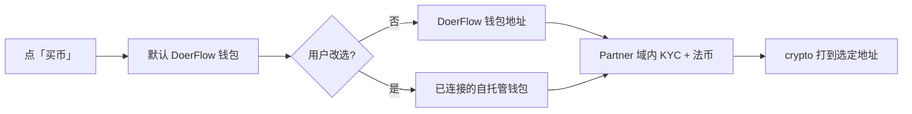

> **规范源文件**：由 MetaRepo `spec/` 同步，请勿直接编辑本页。

# 法币入口 · 合规第三方 Onramp

**版本**: v0.2-draft · **最后更新**: 2026-10-10  
**关联**: [WALLET.md](./WALLET.md) · [BRIDGE.md](./BRIDGE.md) · [PAYMENT_ARCHITECTURE.md](./PAYMENT_ARCHITECTURE.md) · [ROADMAP.md](./ROADMAP.md) § M3

## 1. 合规策略：平台收单，不托管 KYC / 法币

DoerFlow 是**交易平台的收单方**。任务、Escrow、协议费与账本结算以 DoerFlow 为交易对手。到账地址有两个，都是用户自己的钱包，不是平台混池：

- **DoerFlow 钱包**（默认）：统一 App 里的产品钱包，密钥在设备。在 DoerFlow 购买 ETH 等资产时，crypto **默认打到这把钱包**。
- **已连接的外部钱包**：用户在确认前可以改选 WalletConnect / 外部钱包地址。密钥同样不在平台；界面不把这把钱包叫成唯一的「自托管」，以免暗示 DoerFlow 钱包由平台保管。

统一 App 钱包是一等产品，要持续做深，不是 Onramp 的薄封装。

法币兑换与身份核验仍由持牌合作伙伴在其域内完成。DoerFlow **不申请** 汇款牌照、**不托管** 法币、**不存储** 用户银行卡或 KYC 材料。

| 我们做 | 我们不做 |
|--------|----------|
| 作为平台交易的**收单方**（任务、托管、费用、账本） | 把持牌 Onramp 写成平台成交的收单方 |
| 做深非托管钱包：密钥、Vault、余额四态、结算 | 托管用户主私钥，或把钱包做成买币外壳 |
| SDK / Widget **嵌入** 持牌合作伙伴，只用于法币换成 crypto | 自建法币账户、SWIFT、信用卡收单、货币转移 |
| 配置合作伙伴 API Key（服务端/env） | 存储用户身份证件、银行账户 |
| 购买 ETH 等资产默认打到 **DoerFlow 钱包**；用户可改选已连接的外部钱包 | 平台中间 custody 法币、KYC，或把购买资产打进平台混池 |
| 地区可用性检测 + 合规披露 | 在全球无差别提供法币服务 |

**法律边界**：平台成交的法律关系在用户与 **DoerFlow** 之间。法币支付与 KYC 的法律关系在用户与 **Stripe / MoonPay / Transak / Alchemy Pay** 之间。持牌方不是任务与 Escrow 的收单方；DoerFlow 也不是法币机构或 KYC 托管人。会员订阅的 Merchant of Record 仍只经 LuminaryWorks Entitlement，见 [PAYMENT_ARCHITECTURE.md](./PAYMENT_ARCHITECTURE.md) D-PA-09，与本节的平台交易收单分开。

## 2. 架构：Port / Adapter

与 MetaDEX、Bridge 模块一致，链下抽象可换合作伙伴。

```
wallet / web UI
      ↓
@shared/onramp  OnrampService
      ↓
IOnrampProvider (Port)
      ├── StripeOnrampAdapter
      ├── MoonPayAdapter
      ├── TransakAdapter
      └── AlchemyPayAdapter
      ↓
合作伙伴 Widget / Hosted URL（KYC 在对方域内完成）
      ↓
Crypto → 用户钱包地址（on-chain，非托管）
```

### 2.1 Port 接口（`shared` 或 `api` 定义）

```typescript
interface IOnrampProvider {
  id: 'stripe' | 'moonpay' | 'transak' | 'alchemypay';
  getWidgetConfig(params: OnrampWidgetParams): Promise<OnrampWidgetConfig>;
  // 可选：webhook 验签，仅更新订单状态 hash，不存 PII
}

interface OnrampWidgetParams {
  walletAddress: string;      // 必填：收款链上地址
  chainId: number;            // Base / Ethereum / Agent L2
  defaultAsset: 'USDC' | 'ETH';
  fiatCurrency?: string;        // USD, EUR...
  locale?: string;
}
```

### 2.2 仓库职责

| 仓库 | 职责 |
|------|------|
| **shared** | `@vibe-agent/shared/onramp` — 类型、`IOnrampProvider`、`OnrampService`、geo 路由 |
| **api** | `GET /onramp/providers`、`POST /onramp/session`、webhook 中继（无 PII） |
| **wallet** | RN WebView / 原生 SDK 嵌入「买币」 |
| **web** | Modal iframe / 跳转 Hosted Flow |
| **docs** | 用户披露：合作伙伴名称、费用、地区限制 |

## 3. 合作伙伴

| 合作伙伴 | 集成方式 | 主要地区 | 默认资产 | 优先级 |
|----------|----------|----------|----------|--------|
| **Stripe Crypto Onramp** | Embedded iframe | 美国等（以 Stripe 为准） | ETH, USDC | P0 |
| **MoonPay** | Web SDK / RN SDK | 全球多数 | ETH, USDC, USDT | P0 |
| **Transak** | Widget SDK | 全球 | 多链多资产 | P1 |
| **Alchemy Pay** | Widget | 亚太、欧洲 | USDC, 本地法币 | P1 |

**路由策略**（`OnrampService.selectProvider`）：

1. 按用户 IP / 选择国家过滤 **许可证覆盖**  
2. 优先 Stripe（美国）→ MoonPay（全球 fallback）→ Transak → Alchemy Pay  
3. 不可用地区：仅显示「从交易所转入」+ [Base Bridge / 原生桥](./BRIDGE.md) 引导  

## 4. 用户流程



1. 用户点击 **「买币 / Buy Crypto」**
2. 收款钱包默认为 **DoerFlow 钱包**；用户可改选已连接的外部钱包
3. 选择或自动匹配合作伙伴（展示费率提示）
4. 在 **合作伙伴页面** 完成 KYC 与法币支付
5. 资产发送到上一步选定的地址。DoerFlow 钱包在 App 内创建并确认备份后才有地址（见 [WALLET.md](./WALLET.md) FR-WLT-001）。Web 上还没有该地址时，不得把外部连接地址悄悄当成 DoerFlow 钱包，并在选择该默认项时直接说明原因
6. VibeAgent **不接收** webhook 中的姓名、证件号；仅可选记录 `txHash` + `providerOrderId` 用于支持查询

### 4.1 用户可见文案

买币入口先回答「币到哪」，再回答「谁收法币」。平台收单是结算关系，放在第三条，不作为标题。

| 顺序 | 用户要知道的 | 不说成 |
|------|----------------|--------|
| 1 | 默认打到 DoerFlow 钱包，密钥在设备上；可改到已连接的外部钱包 | 把外部钱包叫「自托管」、暗示 DoerFlow 钱包由平台托管 |
| 2 | 付款和身份验证在持牌合作方页面完成；平台不保存银行卡、证件，不代持法币 | 「平台不托管」这种看不出托管什么的句子 |
| 3 | 任务、托管和平台费用仍以 DoerFlow 为交易对手，与这次买币付款分开 | 用收单方 / acquirer 当第一句 |

界面用当前语言展示以上三条。`GET /onramp/disclosure` 的英文 `legalNote` 只给实验室、SDK 和审计，不叠在本地化说明下面。  

## 5. 与跨链协同

| 步骤 | 模块 |
|------|------|
| 法币 → crypto（Base/Ethereum） | **本模块 Onramp** |
| Ethereum → Base | [BRIDGE.md](./BRIDGE.md) Phase 1 · Base Bridge |
| Ethereum → Agent L2 | [BRIDGE.md](./BRIDGE.md) Phase 2 · 原生桥 |
| Base USDC → Agent L2 | 原生桥 或 CCTP（v0.8） |

wallet「入金向导」：**买币 →（可选）跨链 → 可用余额**，一步链式引导。

## 6. 配置与环境

`repos/api/.env.example`（示例）：

```env
# Onramp — 密钥仅存服务端，不下发客户端
STRIPE_ONRAMP_PUBLISHABLE_KEY=
STRIPE_ONRAMP_SECRET_KEY=
MOONPAY_API_KEY=
MOONPAY_SECRET_KEY=
TRANSAK_API_KEY=
ALCHEMYPAY_APP_ID=
ALCHEMYPAY_SECRET=
ONRAMP_WEBHOOK_SECRET=
ONRAMP_GEO_BLOCKLIST=CN,KP,...   # 法务维护
```

客户端仅接收 **短期 session token** 或 **publishable key**，由 api `POST /onramp/session` 签发。

## 7. 需求 ID

| ID | 简述 | 主仓库 | 版本 |
|----|------|--------|------|
| FR-ONRAMP-001 | `IOnrampProvider` Port + shared 包 | shared | v0.3 |
| FR-ONRAMP-002 | MoonPay + Stripe Adapter | wallet, web, api | v0.3 |
| FR-ONRAMP-003 | wallet「买币」WebView 页 | wallet | v0.3 |
| FR-ONRAMP-004 | web Creator 买币 Modal | web | v0.3 |
| FR-ONRAMP-005 | 地区路由 + 合规披露页 | api, docs | v0.3 |
| FR-ONRAMP-006 | Transak + Alchemy Pay Adapter | wallet, web | v0.4 |
| FR-ONRAMP-007 | 入金向导（Onramp + Bridge 链式） | wallet | v0.7 |

FR-ONRAMP-004 证据：web `/payments` 已接买币 Modal（`OnrampBuyModal`，非 live charge）。

## 8. 验收（v0.3）

- [ ] 测试网/主网：MoonPay sandbox 完成一笔 USDC → 测试钱包  
- [ ] Stripe Onramp sandbox（可用地区）  
- [x] 不支持地区 fallback 文案 + 桥引导  
- [x] api 日志 **无 PII** 审计通过  
- [x] 公开 docs 披露：平台交易由 DoerFlow 收单；法币与 KYC 由合作伙伴处理且平台不托管  

**证据（2026-09-10，自动化；不含 live charge）**

| 条 | 证据 |
|----|------|
| 不支持地区 fallback | shared `onramp.service.test.ts`（`geoBlocklist` → `fallback.type=bridge` / `https://bridge.base.org`）；api `onramp.service.spec.ts`（`listProviders`/`createSession` 对 CN 返回 `widget: null` + Base Bridge）；wallet `app/onramp.tsx` 在 `blocked` 时展示 `onramp.unsupportedRegion` / `onramp.openBaseBridge`（en+zh 均含 Base Bridge），`src/i18n/onramp-fallback.test.ts` 断言文案与无 `defaultValue`；web `/payments` `OnrampBuyModal` 对 blocked 展示同一文案并打开 Base Bridge（`onramp-widget.test.ts`，非 live charge） |
| api 日志无 PII | `ONRAMP_SESSION_ALLOWED_KEYS`（walletAddress / chainId / countryCode / providerId / defaultAsset / fiatCurrency / locale）+ `ONRAMP_PII_FORBIDDEN_KEYS`；`onrampPayloadPiiKeys` 断言 blocked 响应无 email/ssn/card；`onramp.service.spec.ts` 扫描 adapters/service 的 `logger.*` 不含 KYC/卡/邮箱字段；MoonPay adapter 仅日志 chainId |
| 公开 docs | `repos/docs/docs/platform/fiat-onramp.md`：平台交易收单方为 DoerFlow；法币与 KYC 不托管，Stripe · MoonPay · Transak · Alchemy Pay 链接 |
| FR-ONRAMP-004 web 买币入口 | `repos/web` `/payments` `OnrampBuyModal`：country → GET `/onramp/providers` → POST `/onramp/session` → HTTPS iframe 或新标签；blocked → Base Bridge。**无 live charge** |
| MoonPay / Stripe sandbox live | **人工** — 本验收不跑 live charge |  

## 9. 明确不做

- 自建 OTC、P2P 法币交易  
- 平台代用户持有法币余额  
- 绕过合作伙伴直接对接银行  
- 在未获法律意见的地区默认展示 Onramp  

---

*跨链见 [BRIDGE.md](./BRIDGE.md)；钱包见 [WALLET.md](./WALLET.md)。*
